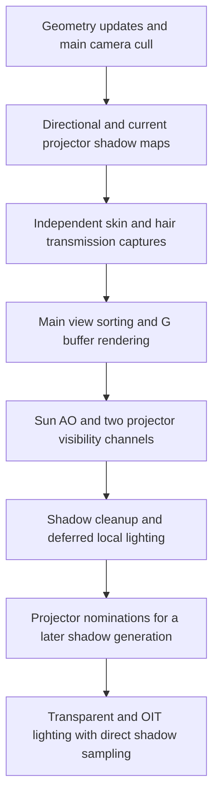

# Lighting and shadow rendering current state

Status: in progress. Initial source audit dated **2026-10-16**; renderer implementation has not started. Source baseline: `7cb3296c4d174202d6caf3a0c127e320fb9e7aaa`, plus the working tree present on that date. `settings.xml` and `FEATURES.md` already contained unrelated edits. The rendering findings below describe the inspected source, not the configuration of a running viewer.

The two-light restriction applies to **ordinary shadowed projector light sources**, not to the number of objects that can cast shadows. Increasing it is feasible. The restriction is embedded in map storage, light selection, shader bindings, opaque shadow-result channels, and several consumers. Raising an array size alone will not produce correct additional shadows.

The strongest direction for a variable count is to give projector shadows their own bounded resource budget, improve selection independently, and test depth-array storage against the earlier four-texture proposal. More lights also require work on receiver lighting, especially transparency and fog, whose budgets are separate. A wholesale renderer replacement is not a prerequisite.

The [implementation plan](LIGHTING-SHADOWS-IMPLEMENTATION-PLAN.md) owns proposed changes, dependencies, acceptance checks, and open decisions. The [September four-projector study](FOUR-PROJECTOR-SHADOWS-PLAN.md) remains historical evidence for a smaller implementation. This document owns current behavior and the reasons behind the plan.

## Existing light and shadow budgets

| System | Current budget and behavior | Consequence |
| --- | --- | --- |
| Ordinary directional shadows | Four allocated sun/moon maps per render-target pack; the main view considers four cascades and probe views two. `RenderShadowSplits` is the last enabled cascade index, normally 3 for four cascades. | These are views of one active celestial light, not four additional local lights. |
| Ordinary projector shadows | Two global depth targets and two current/target/fade slots. Enabled by `RenderShadowDetail > 1`. | Only two local projectors receive ordinary scene shadow maps. |
| Ordinary point lights | Deferred local illumination without an ordinary omnidirectional shadow-map path. | Increasing projector capacity does not give point lights shadows. |
| Deferred local lights | `RenderLocalLightCount`, currently default 256 in the inspected settings. Camera-distance ordering is applied before per-light validity/frustum rejection in the lighting loop. | Many lights can illuminate opaque surfaces while only two projectors are shadowed. The cap is not a guarantee of 256 contributing lights. |
| Forward local lights | Eight legacy light-state positions, with six ordinary local positions at indices 2–7. | This fixed forward budget is distinct from the deferred and shadow budgets. |
| Transparent receiver selection | Up to six local lights per receiver bounds when `RenderAlphaReceiverLights` is enabled; six projected-texture bindings when supported. | More global shadow slots alone cannot make a transparent surface receive every local light. |
| Fog | Up to eight selected local lights, including at most four textured projectors; only the two existing ordinary projector maps can shadow them. | Light count, projected-texture count, and shadow count must not be conflated. |
| Focused skin transmission | Separate sun/moon plus two selected local-light captures for the selected subject. | These encode thickness/entry/exit information and cannot simply become ordinary shadow layers. |
| Focused hair transmission | Separate three-tile bounds/density resources: celestial plus two selected local lights for one nearby subject. | Hair surface highlights use ordinary shadowing; transmission has an independent visibility budget. |

Sources: [pipeline storage and selection](../indra/newview/pipeline.h), [pipeline implementation](../indra/newview/pipeline.cpp), [transparent receiver selector](../indra/newview/llalphalightselection.h), [fog constants](../indra/newview/llvolumefog.h).

The inspected source defaults are `RenderShadowDetail=1`, `RenderShadowResolutionScale=1.0`, `RenderShadowSplits=3`, `RenderLocalLightCount=256`, `RenderAlphaProjectors=true`, `RenderAlphaReceiverLights=true`, `RenderPCSSEnabled=true`, `RenderPCSSQuality=0`, and `RenderPCSSCleanup=3`. Saved user settings, automatic presets, hardware gates, and the current uncommitted defaults work can produce a different live configuration. In particular, PCSS being enabled does not imply projector shadows are enabled. See [settings.xml](../indra/newview/app_settings/settings.xml).

## Frame flow and ownership

The normal main-view flow in [llviewerdisplay.cpp](../indra/newview/llviewerdisplay.cpp), around lines 771–1055, is:

This diagram shows the relevant dependency order, not every post-processing pass. `calcNearbyLights()` is reached through existing render preparation; `setupSpotLight()` nominates projector targets during deferred lighting, after that main frame's shadow generation. The ordinary selector therefore consumes targets from an earlier lighting pass. First-frame fill and changes during movement have this latency in addition to fades.

`renderShadow()` does per-view culling, sorting and submission. Ordinary shadow rendering disables ordinary camera occlusion culling. An object invisible from the eye may still cast a visible shadow, so copying the main camera's visibility list is unsafe. The special skin/hair capture passes reuse a sorted list only where their capture frusta agree. See `renderShadow()` around line 12320 and `generateSunShadow()` around line 13566 in [pipeline.cpp](../indra/newview/pipeline.cpp).

Directional depth targets belong to `RenderTargetPack`: main, auxiliary, and hero-probe packs. The two projector depth targets belong to `LLPipeline` globally. Cubemap updates reuse projector depth maps without renominating their owners or rerendering those maps; receiver matrices are reconstructed for the view. Transparent projector shadow lookup explicitly avoids assigning ordinary shadow slots during cubemap rendering. Preserve or deliberately revise these different behaviors; sharing the word “probe” does not make the paths interchangeable.

The code also has mutable global view state: `sCull`, `LLViewerCamera::sCurCameraID`, render masks, draw pools, geometry rebuild queues and GL state. Calling existing `renderShadow()` instances concurrently would race that state. Independent worker preparation requires immutable input and explicit ownership first.

## How the two projectors are chosen

### Eligibility and ordering

`calcNearbyLights()` filters HUD sources, disallowed attachment lights, and certain muted/complex/slow avatar sources. It orders candidates by camera distance minus the light's authored radius, with a bonus for moving sources and highest priority for selected lights. Equal distance falls back to drawable pointer ordering in `Light::compare`. These rules govern the candidate list, not a measured contribution to the visible image.

The deferred lighting loop visits only the first `RenderLocalLightCount` entries, then rejects negligible color/radius and light bounds outside the camera frustum. Eligible projectors call `updateSpotLightPriority()` and eventually `setupSpotLight()` in either the volume or fullscreen spotlight path. “MultiSpotLight” still draws each projector individually. See [pipeline.cpp](../indra/newview/pipeline.cpp), `calc_light_dist()` at 5893, `calcNearbyLights()` at 5917, and the local-light loop at 9922.

`LLVOVolume::updateSpotLightPriority()` estimates pixel area using a radius-sized box whose center is shifted in the projector direction and against the camera direction. It does not evaluate actual illuminated receiver coverage, light intensity, attenuation at a receiver, cookie brightness, existing occlusion, or shadow rendering cost. The same priority feeds projected-texture streaming statistics, so changing its meaning globally could also change texture loading. A shadow-specific score should leave the texture-priority use intact. See [llvovolume.cpp](../indra/newview/llvovolume.cpp), lines 3456–3478, and its caller in [llviewertexturelist.cpp](../indra/newview/llviewertexturelist.cpp).

`setupSpotLight()` inserts the top two positive priorities into pending slots using strict `>` comparisons. There is no explicit stable object-ID tie-break or benefit threshold for replacing a comparable incumbent. Its draw-order dependence includes separate outside-volume and fullscreen-projector lists. A large dim beam can outrank a small bright beam; a large beam directed away from important receivers can be overvalued. These are consequences of the score, not measured frequencies of failure in-world.

### Handoff and fades

In `generateSunShadow()`, an owner still present in either desired slot fades toward full shadow strength. Others fade toward zero, then take a desired light absent from the other slot. That “other slot” is literally `(i + 1) % 2`; increasing loop bounds would break uniqueness. `mSpotLightFade` is shadow strength; receivers generally get `1 - mSpotLightFade` as the amount added toward fully lit.

Fade progress is elapsed time multiplied by a camera-velocity factor with a minimum of one. Stationary-camera full-range fades therefore take roughly one second; movement can accelerate them. Fades soften the visible transition but do not provide ranking hysteresis. Fading-out owners still consume a slot and render a map.

`[no-shadow]` is read from the emitting prim's cached description. Tagged sources are excluded from nomination and removed from both current and pending slots without the usual fade. Metadata refresh is throttled and asynchronous, so a remote description edit is not guaranteed to appear immediately. Drawable destruction removes matching references. See `setupSpotLight()` at 11673, the handoff at 14118, drawable removal around 2154 in [pipeline.cpp](../indra/newview/pipeline.cpp), and [llvovolume.cpp](../indra/newview/llvovolume.cpp), `projectorShadowsDisabled()`.

### Source hazards to reproduce before changing selection

| Observed control flow | Risk to cover in a regression |
| --- | --- |
| Pending slots are cleared inside the deferred `local_light_count > 0` branch. | Disabling all local lights can leave old nominations available to shadow generation. Move reset/eligibility ownership out of drawing. |
| The ordinary handoff explicitly clears invalid volumes and `[no-shadow]`, but does not itself comprehensively recheck light-enabled state, spotlight type and all candidate rules. | Disabling a light or converting a projector can temporarily retain an obsolete owner. Define immediate invalidation separately from ordinary score-based fades. |
| An empty directional receiver point cloud returns from `generateSunShadow()` before projector maintenance. | A fog-only, transparent-only, or empty opaque view needs deliberate projector behavior and state cleanup. Verify which scenes actually reach this branch. |
| `sampleSpotShadow()` uses the directional `shadow_clip.z/w` distance fade and cutoff. | Local shadow reach is coupled to directional receiver/cascade coverage. A projector range change alone does not remove that limit. |

These are source-level findings and test targets. They have not been demonstrated as live defects in this research pass.

### Existing logic worth reusing

[LLAlphaLightSelection](../indra/newview/llalphalightselection.h) already handles finite bounds, conservative projector intersection, radius/falloff attenuation, contribution ranking, a hierarchy to avoid scoring every light for every receiver, and deterministic ties after UUID ordering. Its score uses peak linear RGB strength, whereas `sssLightScore()` uses luminance. Skin/hair local selection already tests subject/projector intersection, applies a 1.25 incumbent multiplier, and uses a bounded 200 ms time-based fade. Fog uses volume proximity and color, then prefers lights that already have shadow slots.

Reuse the geometry and attenuation principles without treating these selectors as interchangeable. A skin subject is a small sphere, a transparent draw has bounds, fog occupies volumes, and the ordinary shadow scheduler must consider the whole visible view. Copying any one current score unchanged would reproduce that subsystem's biases. The [plan](LIGHTING-SHADOWS-IMPLEMENTATION-PLAN.md#selection-policy) defines a view-level approximation and its limitations.

## Where the two-slot contract is embedded

| Area | Current contract | Required reach of a capacity change |
| --- | --- | --- |
| CPU storage | `mSpotShadow[2]`, current/target/fade arrays of two; combined matrices of six | Construction, initialization, release, drawable removal, assignment, bounds checks, render loops and uniform uploads |
| View IDs | `CAMERA_SPOT_SHADOW0/1` | Distinct view identity for retained per-view cull state; `NUM_CAMERAS` sizes caches in octree/object-cache classes |
| Shader names | Six comparison sampler enums/names and six raw PCSS enums/names | Registration order, type mapping, active-unit assignment, bind/unbind and fallback resources |
| Opaque visibility | One RGBA target: R celestial shadow, G AO, B projector 0, A projector 1 | Additional storage or changed evaluation order; map count alone cannot fix this |
| Opaque spot lighting | `proj_shadow_idx == 0 ? B : A` in both spotlight variants | Arbitrary valid source-to-result mapping, with no stale draw-to-draw binding |
| Shared receivers | `shadow_matrix[6]`, two-way spotlight dispatch, `pcss_inverse_matrix[6]` | Correct indexing, active/valid flags, per-map texel size, comparison/raw sampling |
| Forward alpha and OIT | Six receiver lights, each carrying shadow index/fade; lookup searches two global owners | Wider shadow indices without silently changing receiver-light or cookie limits |
| Fog | Six ordinary shadow matrices/raw samplers and a six-bit validity mask | Wider source mapping and resource validation, retaining four cookie/eight local-light limits until separately changed |
| Preview and diagnostics | Material preview clears six shadow channels; PCSS debug shows two projector fades | Safe preview overrides, generalized diagnostics, no ordinary scene shadows in previews |
| Settings and lifecycle | Shadow mode triggers shader/resource reload; resolution has existing resize behavior | Requested/effective capacity, persistence, presets, Cancel/Default, reload, allocation failure and restart |

Do not mechanically replace every `2`, `4`, `6` or `8`. `mShadowCamera[8]` is two sets of four directional debug cameras. Six forward local slots, three focused transmission views, four sun cascades and four fog cookies represent different contracts. Expanding `NUM_CAMERAS` also increases per-object/group bookkeeping; it is not free CPU storage.

## Shadow generation and receiver costs

### Resolution and memory

`allocateShadowBuffer()` currently allocates all four directional targets when shadows are enabled, even when fewer cascades are rendered. Directional dimensions follow output width/height and scale, rounded by `BlurHappySize()`. Projector maps are square: `R = floor(output_width * RenderShadowResolutionScale)`, with two equally sized maps. Allocation uses [GL_DEPTH_COMPONENT24](../indra/llrender/llrendertarget.cpp). The call from `allocateScreenBuffer()` does not check `allocateShadowBuffer()`'s boolean result; stronger resource handling is a prerequisite for a larger pool.

TAAU reduces the world color buffers but passes the pre-upscale output dimensions to shadow allocation. A lower TAAU world resolution therefore does not itself shrink these shadow maps. See [pipeline.cpp](../indra/newview/pipeline.cpp), lines 923–953 and 1135–1221.

The following is **capacity arithmetic**, assuming four bytes per D24 texel for planning. Actual driver storage, alignment and compression can differ. Values exclude sun maps, screen-space results, other render-target packs, transmission resources and allocation-transition overlap.

| Square side | One projector | Two | Four | Eight |
| --- | ---: | ---: | ---: | ---: |
| 512 | 1 MiB | 2 MiB | 4 MiB | 8 MiB |
| 1024 | 4 MiB | 8 MiB | 16 MiB | 32 MiB |
| 2048 | 16 MiB | 32 MiB | 64 MiB | 128 MiB |
| 4096 | 64 MiB | 128 MiB | 256 MiB | 512 MiB |
| 6880 | 180.57 MiB | 361.13 MiB | 722.27 MiB | 1444.53 MiB |

6880 is the example produced by a 3440-pixel output at scale 2.0. This explains why count and resolution must be budgeted separately. An array reduces texture bindings, not the texel storage required for the same layers and dimensions. A depth texture sampled through both comparison and raw sampler objects is still one image; it costs additional bindings, not a duplicate depth image.

### Sampling and opaque results

The shared [shadowUtil.glsl](../indra/newview/app_settings/shaders/class1/deferred/shadowUtil.glsl) supports hardware comparison filtering and PCSS. The PCSS path has raw-depth samplers for four directional and two projector maps, plus corresponding inverse matrices. [pcssUtil.glsl](../indra/newview/app_settings/shaders/class1/deferred/pcssUtil.glsl) performs blocker search and receiver-plane-aware filtering, with `textureGather` for GLSL 400+ and explicit texel fetches for older variants. Preserve its bias, high-altitude precision, edge and thin-receiver fixes during storage changes.

[sunLightF.glsl](../indra/newview/app_settings/shaders/class2/deferred/sunLightF.glsl) and [sunLightSSAOF.glsl](../indra/newview/app_settings/shaders/class2/deferred/sunLightSSAOF.glsl) resolve two projector visibilities over the opaque screen. [blurLightF.glsl](../indra/newview/app_settings/shaders/class1/deferred/blurLightF.glsl) filters the R/B/A shadow channels while preserving the AO channel as required. [spotLightF.glsl](../indra/newview/app_settings/shaders/class3/deferred/spotLightF.glsl) consumes B/A; [softenLightF.glsl](../indra/newview/app_settings/shaders/class3/deferred/softenLightF.glsl) consumes R/G.

For N projectors, the cost has several independent parts:

- N light-view culls, sorted lists, state changes, skinned/masked/blended submissions and map rasterization for maps updated that frame.
- Shadow evaluation and filtering over affected receivers. Repeating fullscreen resolves for every pair wastes work when beams occupy small screen regions.
- Per-fragment shadow work on transparent layers. Overdraw can make this much more expensive than the opaque resolve.
- Fog ray samples, projected textures, indirect lighting and independent skin/hair captures when enabled.
- Resource memory, texture-cache pressure, map clearing and changes in allocations/resolution.

An increased count need not multiply the whole frame time by the same factor. Conversely, a shader binding optimization does not remove N geometry renders.

### Texture-unit pressure and the earlier study

`loadBasicShaders()` enables alpha projectors at 24 fragment texture units and enables the PCSS-capable and hair-density variants at 32. PCSS being disabled at runtime does not necessarily remove raw samplers from a linked program. [llglslshader.cpp](../indra/llrender/llglslshader.cpp), around lines 552–593, assigns indexed material channels and tracks active channels. [llrender.h](../indra/llrender/llrender.h) also fixes `LL_NUM_TEXTURE_LAYERS` at 32. Checking the driver's maximum alone is insufficient: validate the complete linked program, actual assigned channel range and viewer binding capacity. The combined-stage texture limit is not the fragment-stage limit.

The [September study](FOUR-PROJECTOR-SHADOWS-PLAN.md) reported these linked **fragment-stage** counts on its earlier source:

| Historical variant | Two projectors | Four with comparison and raw samplers | Four using raw projector depth only |
| --- | ---: | ---: | ---: |
| PBR alpha | 31 | 35 | 31 |
| Indexed legacy alpha | 27 | 31 | 27 |
| Legacy material alpha | 30 | 34 | 30 |

It also reported 196,608 matching raw-PCF/hardware-PCF comparisons on one NVIDIA GPU. Those results support a four-light experiment, not today's complete sampler budget or cross-driver filtering equivalence. New hair and other shader work has landed since that audit. Its scratch probe was stored in `%TEMP%/boxxy-four-shadow-probe.py` and is absent at the recorded path now. Recreate a checked-in, repeatable program-level audit before relying on those numbers.

## Options for variable capacity

### Separate depth textures

The previous proposal extends to four ordinary depth images, replaces projector comparison samplers with manual raw-depth PCF in that variant, and adds a second RGBA visibility pair. It has a relatively small integration surface and preserves the current opaque filtering structure. Its disadvantages are growing per-light sampler use, hardcoded sampler dispatch, extra fullscreen resolves, and a manual-PCF cost when PCSS is off. It is a plausible four-light delivery path if a storage-array experiment fails; it is a poor endpoint for an open-ended count.

### Depth texture arrays

One 2D depth array can hold equal-sized projector layers, with a comparison binding and a raw binding independent of layer count. Array-layer coordinates avoid indexing an array of separate sampler uniforms. OpenGL 3.3 includes layered framebuffer attachments and sampler objects; GLSL 3.30 includes `sampler2DArrayShadow`. These are API capabilities, not proof of this viewer's integration or every driver's behavior. See the [OpenGL 3.3 core specification](https://registry.khronos.org/OpenGL/specs/gl/glspec33.core.pdf), sections 3.8 and 4.4.2, and the [GLSL 3.30 specification](https://registry.khronos.org/OpenGL/specs/gl/GLSLangSpec.3.30.pdf), sections 4.1.7 and 8.7.

The viewer loads `glFramebufferTextureLayer` and uses array-related infrastructure for cube-map probes, but [LLRenderTarget](../indra/llrender/llrendertarget.h) does not expose an ordinary layered depth allocation API, and [LLTexUnit](../indra/llrender/llrender.h) lacks a general 2D-array texture type. `LLGLSLShader::mapUniformTextureChannel()` at line 861 in [llglslshader.cpp](../indra/llrender/llglslshader.cpp) also omits `GL_SAMPLER_2D_ARRAY` and `GL_SAMPLER_2D_ARRAY_SHADOW` from its recognized sampler types. This route needs real resource, type-mapping and binding changes; it is not merely substituting a sampler declaration. Preserve target-stack, viewport, memory-accounting and GL context-loss behavior.

The fresh [hidden-context capability query](../output/lighting-research-2026-10-16/capabilities.json) reports 32 fragment texture units, a 32768 maximum texture side and 2048 array layers on this RTX 5090. That establishes API headroom for an experiment on this machine; it does not establish a successful layered allocation, a current complete-program sampler budget or a safe shipping count.

Equal-size layers are a good first experiment. Mixed resolutions later need separate resolution pools or an atlas. Each additional pool adds bindings and selection metadata; an unbounded number of pools would recreate the sampler problem. Changing allocated capacity must not reallocate textures every frame as eligibility fluctuates.

### Depth atlas

A 2D atlas can pack differently sized projector regions into a fixed texel budget and use a bounded number of sampler bindings. It needs rectangle ownership, placement stability, guard regions, per-light scale/bias, and filtering constrained to a tile. Broad PCSS search/filter kernels and hardware-PCF footprints must not read a neighbor's depth. Repacking can invalidate histories and cached maps. This is more allocator/filtering work than equal-size layers and should follow evidence that variable resolution is valuable.

### Opaque visibility is a separate decision

| Evaluation design | Advantages | Costs and correctness requirements |
| --- | --- | --- |
| More packed visibility pairs | Closest to current B/A layout and cleanup; easy reference implementation | O(N) result storage and pair resolves; track pairs across main/probe packs; avoid repeated sun/AO work |
| One visibility layer per projector | Clear identity and independent filtering; can store only visibility | O(N × screen area) memory; layered target and resolve management; decide precision |
| Reusable per-light scratch resolve/filter, then additive spotlight draw | Bounded screen-space storage; resolve can be bounded to the light | More pass transitions; scratch lifetime, filter halo, depth/normal reads and light draw ordering must be correct |
| Direct sampling in each spotlight shader | Removes extra visibility storage and resolves; clip to light influence | Existing deferred cleanup disappears unless replaced; noisy/soft shadows and derivative setup must be revalidated |

Depth arrays solve the depth binding problem. They do not by themselves choose one of these receiver designs. Compare the alternatives with identical shadow quality and inspect transparency separately, since transparent receivers already sample depth directly.

## Better lighting beyond the projector count

### Consistent light eligibility and receiver coverage

The deferred list, receiver-based alpha list, fog list and focused transmission lists have different selection policies. More shadow slots can still leave a visible material boundary if one side receives a light the other omits. Preserve the six-light receiver selector as the existing baseline, then measure the scenes where it fails. Share immutable light identity, transform, color and radius data where useful while keeping each subsystem's receiver query and budget explicit.

Projected images are another independent binding limit: array-backed depth does not remove the six alpha-cookie textures or four fog-cookie textures. A many-light receiver design needs a cookie-storage solution, including streamed/missing textures, aspect ratio, focus/mips, color space and updates. Do not silently convert an overflow projector to an omnidirectional source; fog already avoids that error.

### Clustered lighting

Clustered lighting divides the view into 3D cells and assigns lights to the cells they affect. It can reduce irrelevant fragment lighting work and unify light lists used by opaque, transparent and volumetric receivers. The original [Clustered Deferred and Forward Shading paper](https://research.chalmers.se/publication/161725) explains the advantage over 2D tiling at depth discontinuities. [Filament's implementation notes](https://google.github.io/filament/main/filament.html) describe both CPU and compute assignment and texture-backed lists as an alternative to SSBOs.

For this viewer, the strongest possible benefit is better transparency/fog light coverage and fewer repeated local-light draws. It does not make shadow-map generation free. A hybrid implementation can preserve the G-buffer, material models and post-processing. CPU assignment is a compatibility candidate, not an assumed speedup on an already CPU-limited viewer. Compute/SSBO use needs a capability path, and a depth range derived only from opaque pixels cannot safely cull lights for glass or fog. Overflow must be bounded and reported.

### Stable quality and lower update cost

Treat shadow selection, resolution allocation and update scheduling as three decisions. Stable owners prevent popping; a texel budget bounds memory; an update budget bounds work only if old data remains valid or its approximation is explicitly controlled.

Stationary projector depth is a more promising cache candidate than camera-fitted directional cascades. Even then, light movement/FOV/radius, caster transforms, animation, mesh LOD, alpha texture streaming/animation, material cutoffs, visibility policy and hair deformation can invalidate it. Keep capture transforms with cached data; never attach an old map to new projection metadata. [Epic's shadow-cache documentation](https://dev.epicgames.com/documentation/en-us/unreal-engine/virtual-shadow-maps-in-unreal-engine#caching) identifies light, geometry and deformation changes as major invalidators. Applying that principle here requires viewer-specific invalidation coverage.

Splitting static and dynamic caster depths can help only if the combined depth is available before blocker search and filtering. Taking the minimum of two already-filtered visibility values does not generally reproduce filtering the combined nearest-depth map. Test a conservative whole-map cache first. Skin entry/exit IDs and hair density remain separate correctness problems.

Directional cascade stabilization, tighter conservative light-volume culling, per-light filter quality, and cheaper submission are additional candidates. The existing high-altitude precision and PCSS fixes must survive. Camera-occluded casters and thin alpha geometry remain important stress cases.

### Ambient, indirect and material appearance

More ordinary shadows primarily improve direct projector occlusion. They do not remove excessive ambient/probe illumination, unshadowed point light, fullbright/emissive response, or screen-space indirect-light limitations. The viewer already has PBR/legacy lighting, reflection probes and mirrors, GTAO, SSGI, skin diffusion/transmission, hair response, fog, water transport, exposure and tone mapping. Evaluate direct light, indirect light, emission and exposure separately in a controlled neutral scene before adding another effect.

Keep authored Second Life radius/falloff/intensity and Classic/modern behavior intact during the capacity work. Replacing existing attenuation with a new physically based law would change established content and require a separate compatibility design. Focus on agreement of linear color, projector clipping/ambiance, direct shadow visibility and receiver behavior first. Ambient occlusion and optional screen-space contact shadows can complement direct shadows, but cannot replace offscreen occluders or complete local-light visibility.

Ordinary blended shadow casting is also approximate. For example, [pbrShadowAlphaBlendF.glsl](../indra/newview/app_settings/shaders/class1/deferred/pbrShadowAlphaBlendF.glsl) rejects very low alpha and uses a stipple for intermediate alpha. Exact OIT improves transparent color composition; it does not turn an ordinary single-depth shadow map into colored multilayer transmission. The focused hair density maps address a narrower subject-specific case.

### Larger optional branches

Point-light shadows require omnidirectional coverage, conventionally six cube faces per source, plus receiver distance/depth conventions and filtering across faces. They need their own render-view/texel budget; “eight shadow lights” would otherwise conceal a large difference between eight projectors and eight point lights.

Area lights, colored transmissive shadows, virtual shadow maps and ray-traced shadows are separate projects. Virtual maps need page residency and reliable invalidation; ray tracing would need a supported backend and dynamic scene acceleration structures. Neither is justified as the first dependency for removing a two-projector restriction.

## Performance evidence and its limits

The strongest recent comparison is [ordinary shadow submission on 2026-10-15](../doc/performance/2026-10-15-ordinary-shadow-submission.md). Three warmed captures per build, matching Midday/camera/settings, measured shadow submission means of **1.030 → 0.858 ms** and frame interval **6.314 → 6.044 ms** after skipping inactive hair setup. The same report found different vertex buffers in 192 of 195 simple static entries in one far cascade and rejected an experimental multi-bind path. A general multi-draw rewrite needs actual compatible geometry/data, not just fewer-looking API calls.

Those measurements were on an RTX 5090 in one beach scene with PCSS, skin/hair shading and fog disabled. Active projector-heavy scenes were explicitly still outstanding. They establish neither the marginal cost of a third projector nor an eight-light performance budget.

The [October 11 crowd investigation](../doc/performance/shadow-cpu-2026-10-11.md) found much larger inclusive shadow costs and a smaller culling component. Geometry rebuilds and driver waits can occur inside those scopes. Its camera/environment differed from later captures, so it cannot be compared numerically as an optimization baseline. [Shadows-off captures](../doc/performance/bottleneck-shadows-off-2026-10-11.md) also showed substantial independent skin/hair and other rendering work.

No new live performance capture was taken for this audit. The [2026-10-16 validation record](../doc/performance/2026-10-16-lighting-research-validation.md) records current-source tests: description/slot behavior and the native alpha selector passed; 752 PCSS GPU cases and the alpha/projector lighting cases passed. The projector-cleanup integration fixture fails to link because it lacks newer hair helper definitions. That fixture must be repaired before using it as a gate. These tests do not validate a larger shadow count or the complete viewer sampler assignment.

## Source map for implementation

Line numbers refer to this audit and are navigation hints; use the named symbols after edits.

| Source | Entry points and contracts |
| --- | --- |
| [pipeline.h](../indra/newview/pipeline.h) | `RenderTargetPack` 747; projector targets 775; combined matrices/slots 915–924; `Light::compare` 997 |
| [pipeline.cpp](../indra/newview/pipeline.cpp) | Allocation 953/1135; release 1546; drawable cleanup 2154; nearby selection 5917; shadow bindings 9202/9233; fast/normal receiver bindings 9301/9323; opaque resolve/filter 9720; nominations 9933/11673; fog 11542; alpha candidates 11756 and shadow mapping 12068; `renderShadow` 12320; target access 12754; skin/hair scoring 12890; generation 13566 and handoff 14118 |
| [llviewerdisplay.cpp](../indra/newview/llviewerdisplay.cpp) | Main generation order 826; deferred lighting 1055; cube snapshot generation 1227 |
| [llvovolume.cpp](../indra/newview/llvovolume.cpp) | `updateSpotLightPriority` 3456; description exclusion 3483; light/projector parameters |
| [llviewercamera.h](../indra/newview/llviewercamera.h), [llvieweroctree.h](../indra/newview/llvieweroctree.h), [llvocache.h](../indra/newview/llvocache.h) | Camera enums and per-camera visibility/occlusion/cache arrays |
| [llshadermgr.h](../indra/llrender/llshadermgr.h), [llshadermgr.cpp](../indra/llrender/llshadermgr.cpp), [llglslshader.cpp](../indra/llrender/llglslshader.cpp) | Reserved uniforms, raw/comparison sampler order, indexed channels, type mapping, shader hashing/binding |
| [llviewershadermgr.cpp](../indra/newview/llviewershadermgr.cpp) | Global feature defines 1175; shader variants; fog sampler validation 3649; source/define cache identity |
| [llrender.h](../indra/llrender/llrender.h), [llrender.cpp](../indra/llrender/llrender.cpp), [llrendertarget.h](../indra/llrender/llrendertarget.h), [llrendertarget.cpp](../indra/llrender/llrendertarget.cpp) | Texture target types, binding caches, allocation and target-stack ownership |
| [llgltfmaterialpreviewmgr.cpp](../indra/newview/llgltfmaterialpreviewmgr.cpp) | Preview shadow override around 390 |
| [projectorUtil.glsl](../indra/newview/app_settings/shaders/class1/deferred/projectorUtil.glsl), [shadowUtil.glsl](../indra/newview/app_settings/shaders/class1/deferred/shadowUtil.glsl), [pcssUtil.glsl](../indra/newview/app_settings/shaders/class1/deferred/pcssUtil.glsl) | Shared projection, index/fade forwarding, depth sampling and filter math |
| [sunLightF.glsl](../indra/newview/app_settings/shaders/class2/deferred/sunLightF.glsl), [sunLightSSAOF.glsl](../indra/newview/app_settings/shaders/class2/deferred/sunLightSSAOF.glsl), [blurLightF.glsl](../indra/newview/app_settings/shaders/class1/deferred/blurLightF.glsl), [spotLightF.glsl](../indra/newview/app_settings/shaders/class3/deferred/spotLightF.glsl) | Opaque visibility layout, cleanup, volume/fullscreen consumption |
| [volumeFogLightF.glsl](../indra/newview/app_settings/shaders/class1/deferred/volumeFogLightF.glsl), [pcssDebugF.glsl](../indra/newview/app_settings/shaders/class1/deferred/pcssDebugF.glsl) | Fog matrix/raw-depth dispatch and projector debug visualization |
| [llviewercontrol.cpp](../indra/newview/llviewercontrol.cpp), [llfloaterpreference.cpp](../indra/newview/llfloaterpreference.cpp), [graphics panel](../indra/newview/skins/default/xui/en/panel_preferences_graphics1.xml) | Change callbacks, dependency enablement, Default/Cancel/presets, Shadows section around XML 1011 |
| [llviewerautomation.cpp](../indra/newview/llviewerautomation.cpp), [MCP server](../scripts/viewer_mcp/server.py), [capture documentation](../doc/viewer-mcp.md) | Build/settings/sky metadata, capture semantics, future per-light diagnostics |

## Maintenance

Update the audit date and baseline when the relevant renderer changes. Record newly verified behavior here and move completed implementation tasks in the companion plan only when their acceptance checks have evidence. Keep performance results in dated `doc/performance/` reports with raw artifacts, and link them here without turning scene-specific results into general promises.
